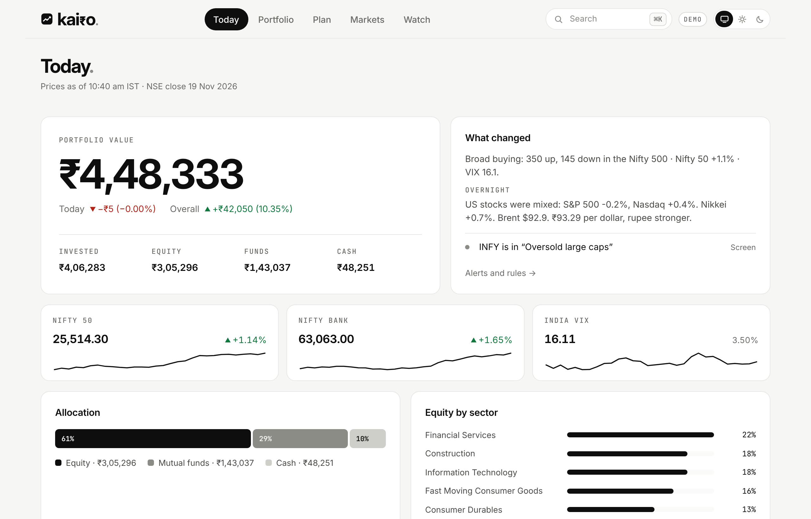
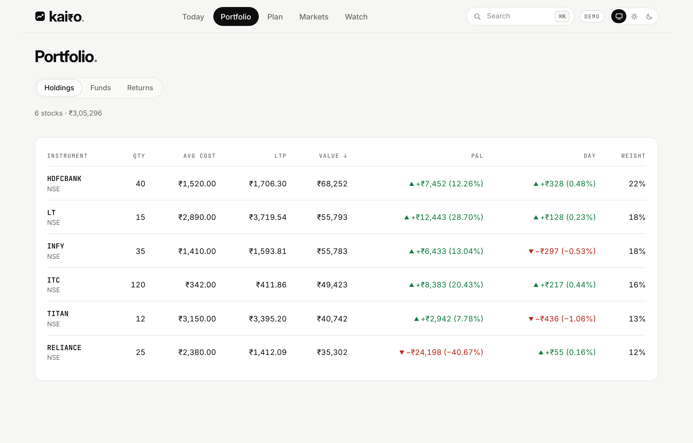
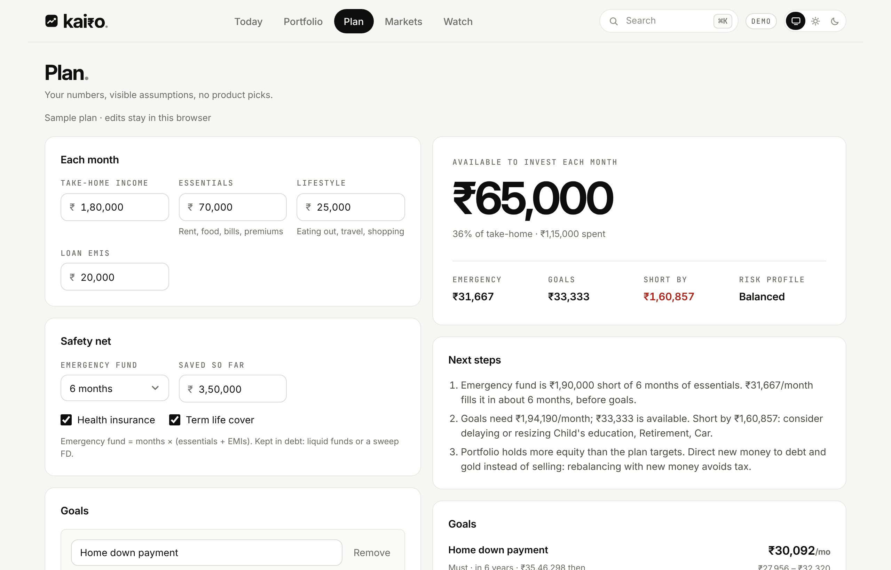
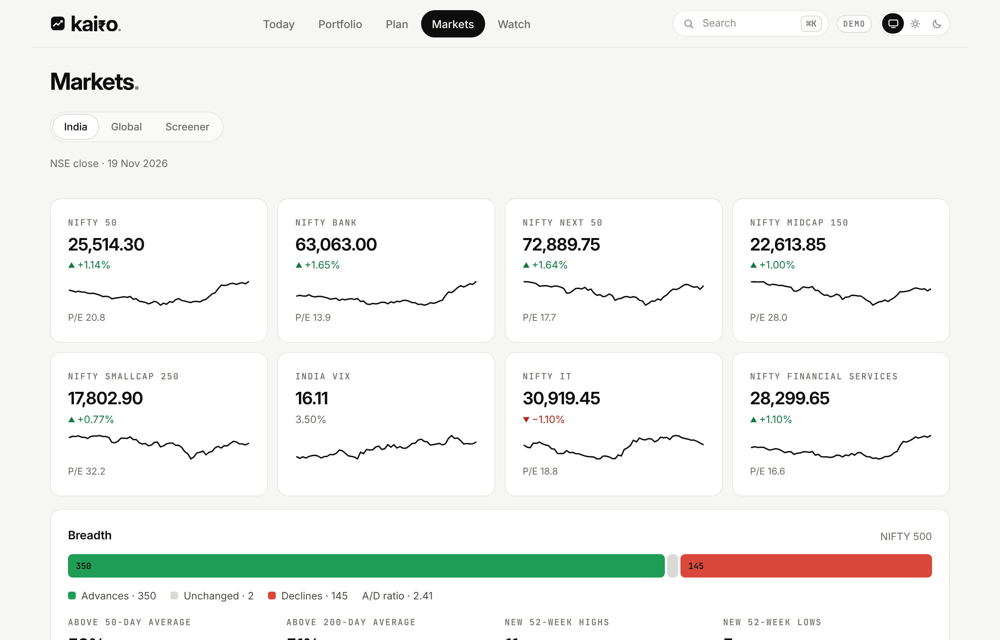
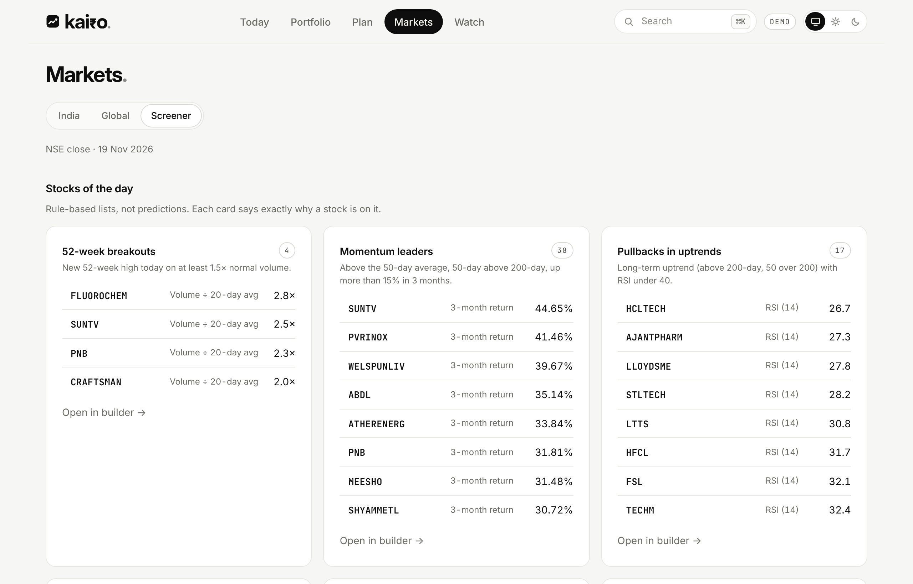
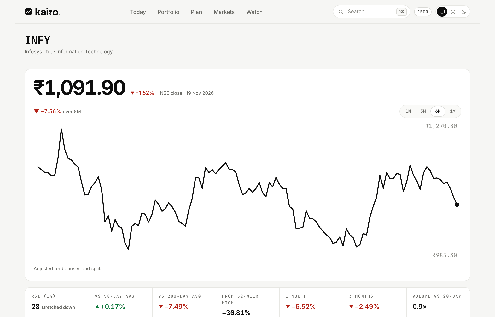
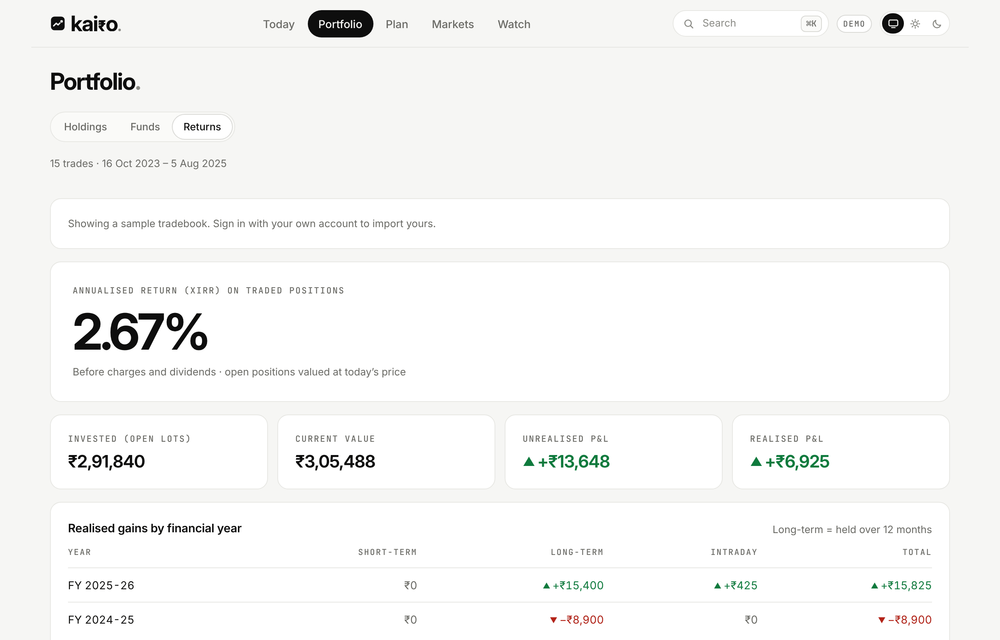
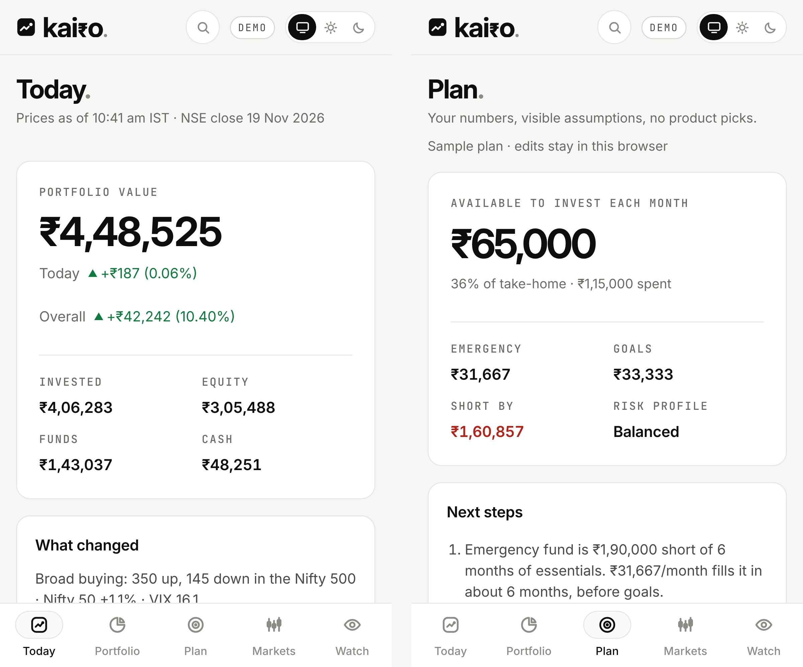
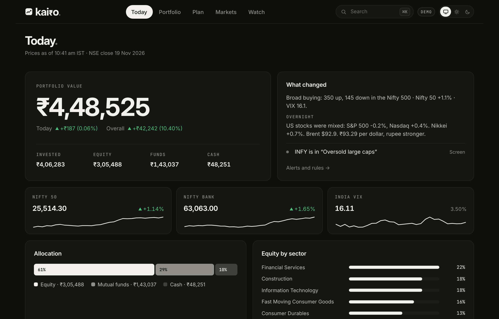

# Kairo

**Your money, the market and your plan, in one calm place.**

Kairo is a personal investing desk for Indian investors who use Zerodha. Open it once a day and you know three things: what you own and how it is doing, what the market did, and whether you are on track for the things you are saving for.

No tips, no hype, no flashing tickers. Just your numbers, explained plainly.

**[Try the live demo →](https://kairo-demo.bhavyladani.in)** A sample portfolio with real NSE market data. No sign-up.

*Kairos (Greek): the right moment.*

---

## What you can do

### See everything you own, in one view

Stocks, mutual funds and cash from your Zerodha account, added up properly. Total value, what you put in, what you have made, today's change, and how your money is spread across sectors.

### Plan for the things that matter

Tell Kairo what you earn and spend, and what you are saving for: a home, a child's education, retirement. It works out:

- how much you can invest each month
- whether your emergency fund is big enough, and how to fill it first
- the monthly amount each goal needs, after inflation
- which goals your money covers, and which it does not
- how your savings should be split between equity, debt and gold, compared with what you actually hold

It shows the trade-offs and lets you decide. It never recommends a specific fund, and every assumption is on screen for you to change.

### Understand the market in a minute

Every evening after the NSE closes, Kairo summarises the day: the major indices, how many stocks rose or fell, which sectors moved, and the biggest movers. Before the market opens, it adds overnight cues from the US and Asia, oil and the rupee.

### Find stocks worth a closer look

"Stocks of the day" are short lists built from clear rules, such as new 52-week highs on heavy volume or strong stocks pulling back. Each list says exactly why a stock is on it. You can also build and save your own rules.

### Look up any stock

Search any NSE stock to see its price history, adjusted for bonuses and splits, and a plain summary of its trend.

### Know how you have really done

Upload your Zerodha tradebook and Kairo shows your true annual return on every stock, realised gains for each financial year (split into short-term, long-term and intraday for tax time), and any gaps between your trades and your holdings.

### Keep watch without staring at screens

Keep a watchlist, and set alerts for a price level, a big move, or a stock entering one of your lists. Kairo checks them after every close, and can message you on Telegram.

---

## Made to be calm

- **Light and dark**, matching your device or chosen by you.
- **Works on your phone**, with a bottom bar for one-thumb use.
- **Quick search**: press ⌘K or / to jump to any page or stock.
- **Colour only means something**: green and red for gains and losses, everything else in black, white and grey.

## Your data stays yours

- **Read-only.** Kairo reads your Zerodha account. It cannot place orders or move money.
- **Private.** Your holdings, plan and trades are never shown on the public demo, and your broker connection is stored encrypted.
- **One owner.** A private Kairo only lets its owner's Zerodha account sign in.

## Good to know

- **Holdings use Zerodha's latest prices.** Market pages use official NSE closing data, refreshed each evening.
- **Zerodha asks you to reconnect once a day.** That is their rule. Kairo keeps you signed in for 30 days and shows your last known holdings until you reconnect.
- **Not investment advice.** Kairo describes what prices did and does the arithmetic on your numbers. Decisions are yours.

---

Building or hosting it yourself? See the [developer guide](docs/development.md).
